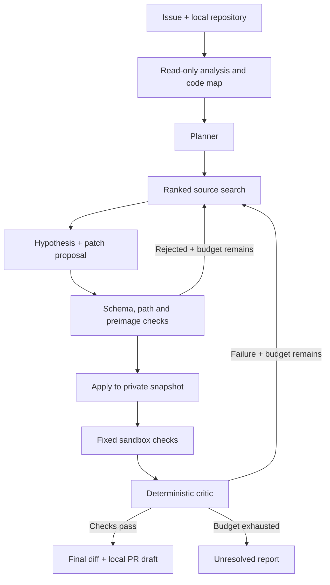

# Architecture

`repository.py` bounds the snapshot, rejects special files, and extracts symbols
without executing modules. `search()` ranks editable source by literal issue-term
frequency. The model does not browse the filesystem directly.

`providers.py` defines the planning and patch interface. The live provider sends
HTTPS JSON requests and validates the returned schema. The scripted provider is
an explicit oracle for harness tests. Only operators configure endpoints, models,
credentials, images, runtimes, budgets, and input/output paths.

`patching.py` permits at most three existing `src/**/*.py` files per attempt.
All edits must have the current preimage SHA-256 and valid Python syntax. Tests,
workflows, configuration, new files, paths outside the source tree, and links are
uneditable. All edits are validated before any are written. The model never
receives a generic write-file or run-command capability.

`ast_sandbox.py` interprets pure single-return functions for the controlled suite.
Arguments and values are plain bounded data. Loops, imports, comprehensions,
recursion, arbitrary attributes/calls, exponentiation, and string formatting are
not implemented. Node/depth/step/value limits bound evaluation. Public failures
provide assertion detail. Hidden failures provide only generic feedback.

`docker_sandbox.py` constructs a fixed Docker command. It binds only the copied
repository and trusted runner, read-only. It runs the prebuilt image by resolved
local image ID with pulls disabled. It does not build images from untrusted
repositories. Stdout is capped; timeouts terminate the CLI and force-remove the
named container. Cleanup problems are blocking results.

`critic.py` is a rule-based gate, not another LLM. It requires at least one genuine
pass and zero failures. Public checks must pass before hidden checks run. Python
test success is labeled `tests_passed`; only independent controlled contracts
produce `resolved`.

`engine.py` maintains the per-problem state, bounded feedback history, patch
attempts, immutable original content, event log, and final artifacts. Rejected
edits consume an attempt. Test failures feed the next proposal; infrastructure
failures stop iteration. It does not require LangGraph or a database to demonstrate
the loop. State is retained in artifacts, but automatic resume is not implemented.

`benchmark.py` validates initial/reference pairs, runs each issue in a fresh
snapshot, checkpoints completed results, and computes aggregate measurements.
Each task gets a new provider usage budget. No oracle data is added to LLM prompts.

